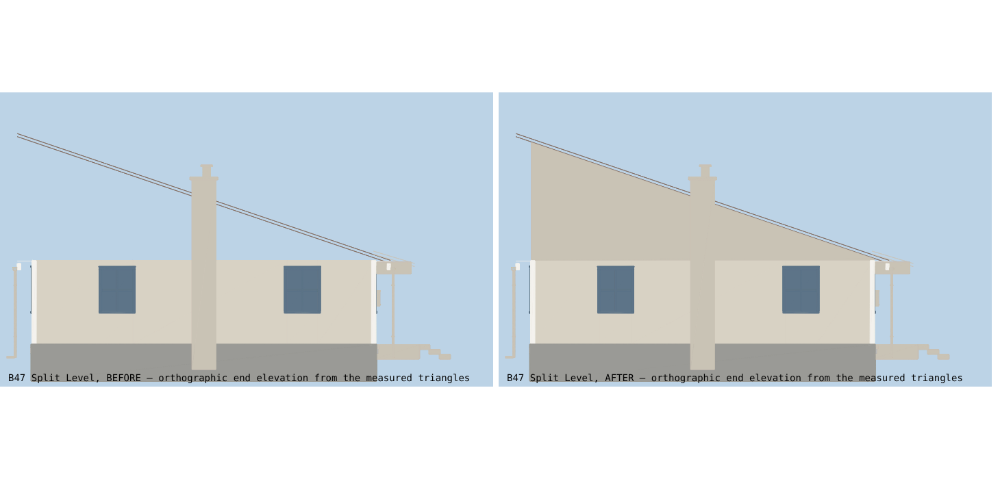
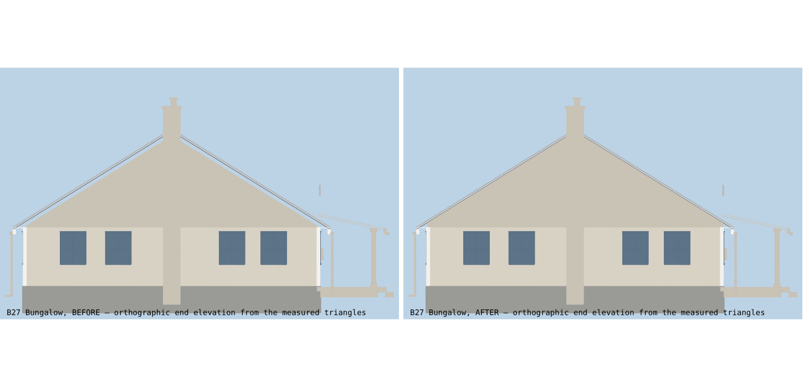
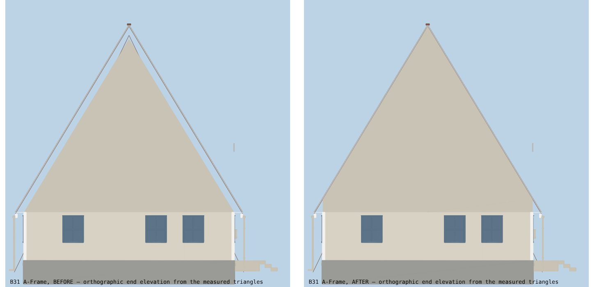

# ashgrove — building inspector report

Generated 2026-11-05T06:29:48.409Z by `node tools/inspector/inspect.js ashgrove`.

| measure | count |
|---|---|
| buildings | 49 |
| buildings with no problem | 11 |
| roof holes (from the sky) | 0 (0.00 m²) |
| roof gaps (from the side) | 0 (0.00 m²) |
| stairs with no landing at the first step | 0 of 22 |
| stairs with no landing past the top | 0 |
| stairs short of headroom | 0 |
| doorways obstructed | 0 of 422 |
| rooms with no way in | 0 |
| rooms blocked only by furniture | 0 |
| rooms cramped (< 35% walkable floor) | 43 |
| parts floating / buried | 0 |
| clipping pairs | 60 |

## Per building

| building | problems |
|---|---|
| [B01 Town Hall](B01.md) | 3 clipping pair(s): L0-R03-F03↔L0-W07, L1-R04-F03↔L1-W08, L1-R05-F02↔L1-W09 |
| [B02 Fire Station](B02.md) | 1 room(s) cramped (<35% walkable floor): L0-R05 Store 28%; 1 clipping pair(s): L0-R04-F02↔L0-W08 |
| [B03 Diner](B03.md) | 2 room(s) cramped (<35% walkable floor): L0-R03 Bath 34%, L0-R04 Store 24%; 1 clipping pair(s): L0-R03-F02↔L0-W07 |
| [B04 Chapel](B04.md) | 1 room(s) cramped (<35% walkable floor): L0-R02 Hall 27% |
| [B05 Library](B05.md) | pass |
| [B06 Clinic](B06.md) | 2 clipping pair(s): L0-R04-F03↔L0-W08, L0-R05-F03↔L0-W09 |
| [B07 Schoolhouse](B07.md) | 1 clipping pair(s): L0-R06-F02↔L0-W10 |
| [B08 General Store](B08.md) | 1 room(s) cramped (<35% walkable floor): L0-R02 Store 28%; 1 clipping pair(s): L0-R03-F03↔L0-W07 |
| [B09 Barn](B09.md) | 2 room(s) cramped (<35% walkable floor): L0-R02 Store 28%, L0-R03 Store 29% |
| [B10 Post Office](B10.md) | pass |
| [B11 Cottage](B11.md) | pass |
| [B12 Tudor](B12.md) | 2 room(s) cramped (<35% walkable floor): L0-R06 WC 13%, L0-R07 Laundry 13%; 2 clipping pair(s): L0-R06-F02↔L0-W10, L1-R05-F02↔L1-W09 |
| [B13 Ranch](B13.md) | 1 clipping pair(s): L0-R06-F02↔L0-W10 |
| [B14 Cottage](B14.md) | pass |
| [B15 Tudor](B15.md) | 2 room(s) cramped (<35% walkable floor): L0-R06 WC 13%, L0-R07 Laundry 13%; 2 clipping pair(s): L0-R06-F02↔L0-W10, L1-R05-F02↔L1-W09 |
| [B16 Duplex](B16.md) | 2 clipping pair(s): L0-R07-F02↔L0-W11, L0-R08-F02↔L0-W12 |
| [B17 Duplex](B17.md) | 2 clipping pair(s): L0-R07-F02↔L0-W11, L0-R08-F02↔L0-W12 |
| [B18 Duplex](B18.md) | 2 clipping pair(s): L0-R07-F02↔L0-W11, L0-R08-F02↔L0-W12 |
| [B19 Cottage](B19.md) | pass |
| [B20 Ranch](B20.md) | 1 clipping pair(s): L0-R06-F02↔L0-W10 |
| [B21 Ranch](B21.md) | 1 clipping pair(s): L0-R06-F02↔L0-W10 |
| [B22 Colonial](B22.md) | 3 room(s) cramped (<35% walkable floor): L0-R04 Kitchen 6%, L0-R05 Dining 18%, L0-R06 WC 16%; 3 clipping pair(s): L0-R01-F02↔L0-W05, L0-R06-F02↔L0-W10, L1-R05-F02↔L1-W09 |
| [B23 Colonial](B23.md) | 3 room(s) cramped (<35% walkable floor): L0-R04 Kitchen 6%, L0-R05 Dining 18%, L0-R06 WC 16%; 3 clipping pair(s): L0-R01-F02↔L0-W05, L0-R06-F02↔L0-W10, L1-R05-F02↔L1-W09 |
| [B24 Tudor](B24.md) | 2 room(s) cramped (<35% walkable floor): L0-R06 WC 13%, L0-R07 Laundry 13%; 2 clipping pair(s): L0-R06-F02↔L0-W10, L1-R05-F02↔L1-W09 |
| [B25 Colonial](B25.md) | 3 room(s) cramped (<35% walkable floor): L0-R04 Kitchen 6%, L0-R05 Dining 18%, L0-R06 WC 16%; 3 clipping pair(s): L0-R01-F02↔L0-W05, L0-R06-F02↔L0-W10, L1-R05-F02↔L1-W09 |
| [B26 Farmhouse](B26.md) | 1 room(s) cramped (<35% walkable floor): L0-R04 Kitchen 5%; 2 clipping pair(s): L0-R06-F02↔L0-W10, L1-R05-F02↔L1-W09 |
| [B27 Bungalow](B27.md) | 1 clipping pair(s): L0-R05-F02↔L0-W09 |
| [B28 Bungalow](B28.md) | 1 clipping pair(s): L0-R05-F02↔L0-W09 |
| [B29 Bungalow](B29.md) | 1 clipping pair(s): L0-R05-F02↔L0-W09 |
| [B30 Farmhouse](B30.md) | 1 room(s) cramped (<35% walkable floor): L0-R04 Kitchen 5%; 2 clipping pair(s): L0-R06-F02↔L0-W10, L1-R05-F02↔L1-W09 |
| [B31 A-Frame](B31.md) | pass |
| [B32 Modern](B32.md) | 2 clipping pair(s): L0-R06-F02↔L0-W10, L1-R05-F02↔L1-W09 |
| [B33 Modern](B33.md) | 2 clipping pair(s): L0-R06-F02↔L0-W10, L1-R05-F02↔L1-W09 |
| [B34 Farmhouse](B34.md) | 1 room(s) cramped (<35% walkable floor): L0-R04 Kitchen 5%; 2 clipping pair(s): L0-R06-F02↔L0-W10, L1-R05-F02↔L1-W09 |
| [B35 Modern](B35.md) | 2 clipping pair(s): L0-R06-F02↔L0-W10, L1-R05-F02↔L1-W09 |
| [B36 A-Frame](B36.md) | pass |
| [B37 A-Frame](B37.md) | pass |
| [B38 Townhouse](B38.md) | pass |
| [B39 Cape Cod](B39.md) | 3 room(s) cramped (<35% walkable floor): L0-R04 Kitchen 7%, L0-R05 Dining 7%, L1-R02 Bedroom 34%; 1 clipping pair(s): L0-R01-F02↔L0-W05 |
| [B40 Cape Cod](B40.md) | 3 room(s) cramped (<35% walkable floor): L0-R04 Kitchen 7%, L0-R05 Dining 7%, L1-R02 Bedroom 34%; 1 clipping pair(s): L0-R01-F02↔L0-W05 |
| [B41 Townhouse](B41.md) | pass |
| [B42 Cape Cod](B42.md) | 3 room(s) cramped (<35% walkable floor): L0-R04 Kitchen 7%, L0-R05 Dining 7%, L1-R02 Bedroom 34%; 1 clipping pair(s): L0-R01-F02↔L0-W05 |
| [B43 Victorian](B43.md) | 2 room(s) cramped (<35% walkable floor): L0-R06 WC 10%, L0-R07 Laundry 9%; 2 clipping pair(s): L0-R06-F02↔L0-W10, L1-R05-F02↔L1-W09 |
| [B44 Victorian](B44.md) | 2 room(s) cramped (<35% walkable floor): L0-R06 WC 10%, L0-R07 Laundry 9%; 2 clipping pair(s): L0-R06-F02↔L0-W10, L1-R05-F02↔L1-W09 |
| [B45 Townhouse](B45.md) | pass |
| [B46 Victorian](B46.md) | 2 room(s) cramped (<35% walkable floor): L0-R06 WC 10%, L0-R07 Laundry 9%; 2 clipping pair(s): L0-R06-F02↔L0-W10, L1-R05-F02↔L1-W09 |
| [B47 Split Level](B47.md) | 1 room(s) cramped (<35% walkable floor): L0-R07 Bedroom 8%; 1 clipping pair(s): L0-R06-F02↔L0-W10 |
| [B48 Split Level](B48.md) | 1 room(s) cramped (<35% walkable floor): L0-R07 Bedroom 8%; 1 clipping pair(s): L0-R06-F02↔L0-W10 |
| [B49 Split Level](B49.md) | 1 room(s) cramped (<35% walkable floor): L0-R07 Bedroom 8%; 1 clipping pair(s): L0-R06-F02↔L0-W10 |

Inventory (built / planned / in files but never shown): [INVENTORY.md](INVENTORY.md)

## Evidence (before → after, measured end elevations)

